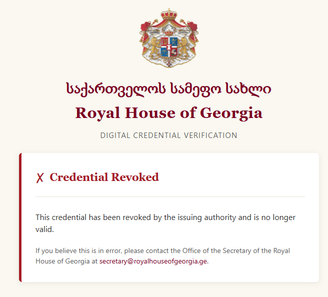
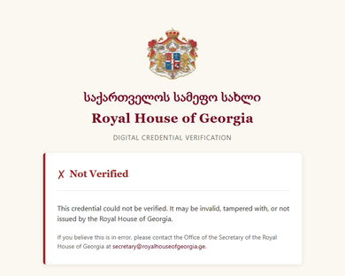

# Digital Honor Authenticator

საქართველოს სამეფო სახლი · Royal House of Georgia

**A system for issuing and verifying royal honors.** This document explains how the Royal House of Georgia issues cryptographically verified honors, and how anyone can confirm that a diploma is genuine. It is written for recipients, institutions and members of the Royal House; no technical background is needed. Technical documentation is listed in [Further technical detail](#11-further-technical-detail).

## 1. What is this system?

The Royal House of Georgia confers honors — orders, titles and distinctions — on individuals in recognition of distinguished service or merit. These honors are formally recorded on physical diplomas, signed and sealed by the Head of the Royal House.

This system adds a layer of protection that a physical seal alone cannot provide: a mathematical proof of authenticity that anyone, anywhere in the world, can check instantly by scanning a QR code on the diploma.

The proof is created by the Grand Master with a small hardware device called a YubiKey, which stays in the Grand Master's possession. Without it, no one can issue a credential in the name of the Royal House.

> **In plain terms**
> Think of it as a wax seal that cannot be copied. A traditional seal can be replicated with the right tools and materials. This one cannot: the mathematics behind it make forgery computationally impossible, even for someone with powerful computers.

## 2. The problem it solves

The Royal House operates across multiple locations. The Head of the Royal House may sign diplomas in advance that are later completed and presented by a representative in another country.

That creates a risk: a diploma bearing the Head's signature could be completed fraudulently, or a genuine diploma could be altered after signing — and a recipient, an institution or a member of the public had no reliable way to tell.

- **The risk:** anyone holding a pre-signed diploma could fill it in with any name and any honor.
- **The gap:** no one could independently confirm that the details on a diploma are what the Royal House actually issued.
- **The solution:** each honor is digitally signed at the moment it is issued. The signature locks the exact recipient name, honor, specific distinction and date. Any later change breaks it.

## 3. How it works

1. **Issue.** The Grand Master enters four details — the recipient's name, the honor (chosen from the list of recognized honors), the specific distinction or rank, and the date — and signs them with the YubiKey, which asks for its PIN. The app produces a QR code, as a vector file (SVG) for the diploma designer or as a high-resolution image (PNG).
2. **Print.** The QR code is printed on the diploma alongside the traditional seal and signature, at least 3 × 3 cm. The QR code itself carries the complete proof of authenticity; nothing else needs to be stored anywhere for it to be checked.
3. **Verify.** Anyone scans the QR code with a phone camera. A page opens showing whether the diploma is authentic, and the exact details that were signed.

Verification needs no app, no account and no fee. The page is open to anyone with an internet connection.

## 4. Verifying a diploma

Scanning the QR code opens the Royal House's verification page at **https://verify.royalhouseofgeorgia.ge**. The page checks the credential automatically and shows one of five results.

| Result | What it means |
|---|---|
| **Verified** | The diploma is genuine. The page shows the signed details: **Recipient**, **Honor**, **Detail**, **Date**, and the **Authority** whose key signed it. If the list of revoked credentials could not be checked at that moment, the page says so. |
| **Credential Revoked** | The credential carries a genuine signature, but the Royal House has since withdrawn the honor. This is different from a forgery: the diploma was genuine when issued. |
| **Not Verified** | The credential failed the check: the diploma or its QR code was altered, fabricated, or not issued by the Royal House. No credential details are shown. |
| **Verification Error** | The check could not be completed: the page could not reach the list of Royal House keys (for example, no internet connection), or the link's encoded data is damaged. |
| **Digital Credential Verification** | The page was opened without a credential — typed into a browser rather than scanned — or with a missing or incomplete link. It explains what the page is for and links to the Royal House website. |

**Not Verified**, **Credential Revoked** and **Verification Error** also give a contact for questions: the Office of the Secretary of the Royal House of Georgia, at secretary@royalhouseofgeorgia.ge.

Revocation protects privacy: the public list of revoked credentials holds only an unreadable fingerprint of each credential, never a name or any other detail.

The screenshots below show a sample credential signed with a test key. A real credential shows the name of the issuing authority instead of "Test Authority".

*Figure 1. Verified — sample credential signed with a test key.*

*Figure 2. Credential Revoked.*

*Figure 3. Not Verified.*

## 5. The YubiKey: the Grand Master's signing device

The YubiKey is a small hardware device, similar in size to a USB drive, that holds the Grand Master's private signing key. It is the physical root of trust for the whole system. The system uses a YubiKey 5 series device with firmware 5.7 or later.

- **The private key is created inside the device and never leaves it.** It cannot be copied, exported or read by any software.
- **Signing requires the device's PIN.** Someone who obtains the device cannot sign without the PIN; someone who knows the PIN cannot sign without the device. The signing app can remember the PIN for a few minutes, so that several diplomas can be signed in one sitting, and signing a batch from a file asks for it once. A YubiKey can also be set up to require a physical touch for every signature.
- **It is small enough to keep with you at all times.**

> **What this means in practice**
> No one can issue a credential in the name of the Royal House without the YubiKey in hand and its PIN. This holds however sophisticated the attacker is, and however many computers they control.

## 6. The key registry

The counterpart of the private key in the YubiKey is a public verification key. It is published openly in the Royal House key registry:

**https://verify.royalhouseofgeorgia.ge/keys/registry.json**

The public key cannot be used to sign anything; it can only check signatures. Publishing it lets anyone confirm that a signature is genuine without contacting the Royal House.

This is the core idea of public-key cryptography. Two mathematically linked keys are used: a private key that signs, and a public key that verifies. The private key never leaves the YubiKey. The public key can be shared with the whole world without any loss of security, because it is computationally impossible to work back from it to the private key.

Wide availability of the public key is therefore not a weakness but a design goal: the more widely it is known, the less verification depends on any single party. A government ministry, a university admissions office or a private individual can verify a diploma without asking anyone's permission.

Each registry entry also names its **authority** — the person whose key it is. That name is what the verification page shows under **Authority**; it comes from the registry, not from the credential.

The registry is designed to be permanent:

- **Nothing is ever deleted.** Every key that has ever been used stays in the registry, so credentials signed today can still be verified in twenty years.
- **A key's use can be ended.** If a YubiKey is replaced, its key is given an end date and a new key is added. Credentials dated up to the end date keep verifying; anything dated later fails.
- **A key can be limited to certain honors.** A key may, for example, be allowed to sign appointments only. The verification page rejects a credential for an honor its key was not allowed to sign.
- **Succession is recorded.** When signing authority passes to a successor, their key is added alongside all previous ones.

## 7. Issuing an honor: the Grand Master's app

Credentials are issued with **RHG Authenticator**, a desktop app installed on the signing computer. It is not a website and has no server of its own. There is a Mac version (macOS 14 or later, on a Mac with Apple silicon) and a Windows version (Windows 10 or 11). The Mac version updates itself; the Windows version shows a link to download each new version.

When the app starts, it downloads the key registry. **Without the registry, the app refuses to sign**, so that it never produces a credential that would not verify. Before asking for the PIN, it also checks that the inserted YubiKey's key is in the registry, is valid on the credential's date, and is allowed to sign that honor.

Signing a credential takes four steps:

1. Fill in **Recipient**, **Honor**, **Detail** and **Date** (today by default).
2. Insert the YubiKey and click **Sign Credential**.
3. Enter the YubiKey's PIN (and touch the YubiKey if it was set up to require that).
4. The QR code appears. Save it as an SVG for the diploma designer or as a high-resolution PNG, or copy its verification link.

If the same credential — identical recipient, honor, detail and date — is already in this computer's record of issued credentials, the app shows the original QR code again, without asking for the PIN and without adding a new record.

The app has five sections (tabs); the Windows version adds a sixth, **Help**:

| Tab | What it does |
|---|---|
| **Sign** | The credential form above. **Bulk Sign from File…** signs many credentials from a spreadsheet (CSV) with one PIN entry. |
| **History** | Every credential issued on this computer, searchable by recipient. **Revoke** withdraws a credential by proposing it for the public revocation list; the maintainer of the repository approves the change. If the credential is already revoked, or its revocation is already waiting, no second request is made. **Delete Entry…**, **Export Issuance Log…** and **Remove Duplicates…** manage the record itself. |
| **Registry** | Shows the key registry. A new key can be imported directly from a YubiKey or from a certificate file, and entries can be added or edited. Changes are never applied directly: **Submit for Review** sends them to the maintainer of the repository for approval. |
| **Audit** | The complete change history of the registry, so any change to it can be checked. |
| **YubiKey** | Checks the inserted YubiKey without a PIN: whether its key is in the registry, and which honors it may sign. |

Revoking a credential and submitting registry changes need a GitHub login, done once through the browser; the login is kept in the computer's secure password store (the Mac Keychain or the Windows Credential Manager).

## 8. What cannot be faked

The system was built with specific threats in mind. This is how each is handled.

| Concern | How it is addressed |
|---|---|
| Someone issues a diploma without the knowledge of the Head of the Royal House | Every credential requires the physical YubiKey and its PIN. No software workaround exists. |
| A genuine diploma is altered after signing | The signature covers every detail of the credential: recipient name, honor, specific distinction and date. Changing a single character breaks it, and verification fails. |
| Someone creates a fake QR code | The QR code carries a mathematical proof. Without the private key, a valid proof cannot be made for invented details. |
| A key is used outside its validity | A credential verifies only if it is dated on or before its key's end date, and only for honors the key is allowed to sign. The verification page enforces this; the app checks the same rules before signing so that it never wastes a signature. |
| The verification website goes offline | The full proof is contained in the QR code's link. Technical users can check it independently with standard open-source tools, without the website. |
| The Grand Master loses the YubiKey | The lost key is given an end date in the registry, a new YubiKey is set up, and its key is added. Credentials dated after the end date fail verification. Credentials dated before it still verify — the genuine ones, but also any that someone holding the lost key **and** its PIN could sign with an earlier date. Such credentials look identical to genuine ones; any that come to light can be revoked individually. This is why the PIN must be kept secret, and why a lost key should be reported at once. |
| Signing authority passes to a successor | The successor's key is added to the registry. The record of all previous keys is kept permanently. |
| A credential must be withdrawn after issuance | The Grand Master uses **Revoke** in the History tab. Once the revocation is approved, the verification page shows **Credential Revoked**. Only an unreadable fingerprint of the credential is published, never personal details. |

## 9. What this system does not require

Several technologies that might seem relevant were considered and ruled out. Each decision keeps the system simpler and more durable.

- **No blockchain.** The cryptographic signature alone proves authenticity. A blockchain would add cost, complexity and ongoing dependency without any security benefit.
- **No third-party verification service.** There is no vendor that could shut down, change its prices or end support.
- **No app for verifiers.** Recipients and verifiers need only a phone camera.
- **No account or registration.** Anyone can verify any diploma at any time.
- **No ongoing fees** beyond maintaining the Royal House's domain.

## 10. Privacy and data

The system keeps data to a minimum. A credential contains only what is entered when it is issued — **recipient name, honor, specific distinction and date** — the same information that appears on the face of the diploma. The signing authority is not stored in the credential; the verification page looks it up in the public key registry.

No contact details, address, nationality or any other personal data is collected.

The verification page uses no cookies, collects no analytics and keeps no record of who verified a diploma or when. (The services that host the page may keep ordinary technical access logs, as any website host does.)

The signing computer keeps a record of every credential it has issued, including each recipient's details, so that credentials can be found and revoked later. This record stays on that computer; it can be exported as a file for safekeeping.

## 11. Further technical detail

The full technical documentation — the credential format, the cryptographic design and security model, the key registry format and the developer guides — is in the public repository:

**https://github.com/RoyalHouseOfGeorgia/rhg_authenticator**

The system consists of the signing apps for Mac and Windows, built on a shared core written in Go; the verification page and its TypeScript library; and a few maintenance tools. The repository's [README](README.md) lists the documentation and the current number of automated tests; [ARCHITECTURE.md](ARCHITECTURE.md) describes the system design and security model. Every release is published with SHA-256 checksums and build provenance attestations, so anyone can confirm that a download was built from the published source code.

## 12. References

The following standards and publications underpin the design of this system.

- **Edwards-Curve Digital Signature Algorithm (EdDSA).** RFC 8032, Internet Engineering Task Force (IETF), January 2017. [rfc-editor.org/rfc/rfc8032](https://www.rfc-editor.org/rfc/rfc8032)
  Defines Ed25519, the signature scheme used to sign and verify every credential. Ed25519 was chosen for its strong security, compact signatures and resistance to implementation errors.
- **Personal Identity Verification (PIV).** FIPS 201-3, National Institute of Standards and Technology (NIST), January 2022. [doi.org/10.6028/NIST.FIPS.201-3](https://doi.org/10.6028/NIST.FIPS.201-3)
  Governs how cryptographic keys are stored and used on hardware security devices. The YubiKey 5 series (firmware 5.7 or later) implements it, so the Grand Master's private key is created on the device, cannot be exported, and can only be used with the PIN (and a touch, if the key is set up to require one).
- **Verifiable Credentials Data Model.** W3C Recommendation, World Wide Web Consortium, March 2022. [w3.org/TR/vc-data-model](https://www.w3.org/TR/vc-data-model/)
  An international standard for expressing cryptographically verifiable digital credentials. The credential format used here follows its principles, adapted to the needs of the Royal House.
- **Diffie, W. and Hellman, M. "New Directions in Cryptography."** IEEE Transactions on Information Theory, Vol. 22, No. 6, November 1976. [doi.org/10.1109/TIT.1976.1055638](https://doi.org/10.1109/TIT.1976.1055638)
  The founding paper of public-key cryptography. Its principle — that the key used to verify need not be kept secret — is why the Grand Master's verification key can be published openly.
